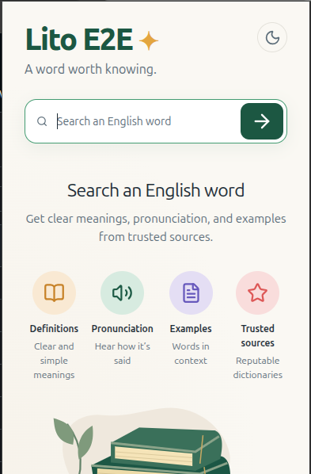
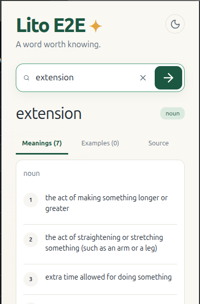

# Lito Dictionary extension


React + TypeScript + Vite, WebExtensions Manifest V3. Browser targets cover desktop Chrome/Brave/Edge, Firefox 140+, and Safari 18+ packaging. The popup uses the Laravel public API for live Merriam-Webster definitions; it never calls Merriam-Webster directly. API contract and licensing decision: `../backend/docs/public-lookup-api.md`.

## Current design

The popup uses a centered, warm dictionary-card layout with the supplied Lito Dictionary branding:

- The header shows the wide **Lito Dictionary** logo, the “A word worth knowing.” tagline, and a light/dark theme button. The supplied square logo is used for the Chrome toolbar, extension listing, and page icon. Both original images live in `public/branding/`; Chrome scales the square artwork to its icon sizes.
- The search control is full-width with a Lucide search icon, clear control, and centered arrow submit button.
- The empty state explains the four capabilities: definitions, pronunciation, examples, and trusted sources. It includes the built-in books illustration.
- A successful lookup shows the word, part-of-speech badge, pronunciation/audio when available, and tabs for **Meanings**, **Examples**, and **Source**.
- Meanings are displayed in numbered cards; source attribution remains visible with the official Merriam-Webster logo when applicable.
- Loading, unavailable-provider, and not-found states have their own centered messages.

Tailwind CSS is loaded through the Vite plugin, while the design tokens and extension-specific layout rules remain in `src/style.css`. Interface icons come from `lucide-react`; the books illustration is the product artwork rather than an icon.

### Welcome screen

These screenshots show the earlier Lito E2E branding; the current build uses the Lito Dictionary logo above.



### Lookup result



## Development and loading Chrome

1. Start Laravel from `backend/` with `php artisan serve --host=127.0.0.1 --port=8000`. Configure the existing server-side `MERRIAM_WEBSTER_PRODUCT` and matching API key. No fixture seeding is required.
2. From `extension/`, run `npm ci` and `npm run build:dev`. Default endpoint: `http://localhost:8000/api/v1/dictionary/lookup`.
3. Open `chrome://extensions`, enable **Developer mode**, choose **Load unpacked**, then select `/home/zypp/code/lito-dictionary/extension/dist`.
4. Pin **Lito Dictionary**. Open its popup and search `hello`. Search other words such as `cat` or `apple` too. Results show Merriam-Webster’s logo and source name. Each search uses the live provider without permanent storage. A miss displays not-found. Stop Laravel to see the network-error state.
5. After edits run `npm run build:dev`, then click Reload on the extension card and reopen the popup. Do not load the Vite development server as an extension.

## Endpoint configuration

Create `.env.development.local` with `VITE_API_URL=http://localhost:8000/api/v1/dictionary/lookup` if changing development setup. For production create `.env.production.local` with `VITE_API_URL=https://YOUR-BACKEND/api/v1/dictionary/lookup`, then run `npm run build`. The build intentionally refuses a missing production endpoint or plain HTTP. These files are ignored. The URL is public configuration, never put provider keys into any `VITE_` variable.

## Other desktop browsers

Run `npm run build:all:dev` to prepare all three folders with the local Laravel URL. Each target has its own output, so rebuilding Firefox or Safari does not overwrite the installed Chrome/Brave/Edge extension.

| Browser | Development command | Output | Load locally |
| --- | --- | --- | --- |
| Chrome | `npm run build:dev` | `dist/` | `chrome://extensions` → Developer mode → Load unpacked |
| Brave | `npm run build:dev` | `dist/` | `brave://extensions` → Developer mode → Load unpacked |
| Microsoft Edge | `npm run build:dev` | `dist/` | `edge://extensions` → Developer mode → Load unpacked |
| Firefox 140+ | `npm run build:firefox:dev` | `dist-firefox/` | `about:debugging#/runtime/this-firefox` → Load Temporary Add-on → select `manifest.json` |
| Safari 18+ on macOS | `npm run build:safari:dev` | `dist-safari/` | Package with Xcode on a Mac, then enable in Safari |

After loading, allow access to the configured API host if the browser asks. In Firefox, check the add-on's Permissions if lookup requests cannot reach Laravel. Temporary Firefox installations disappear when Firefox restarts; permanent distribution requires Mozilla signing. The stable Firefox extension ID is `lito-dictionary@saseuz`; keep it for future updates once published.

Production commands are `npm run build`, `npm run build:firefox`, and `npm run build:safari`. All require the configured HTTPS endpoint. These commands build files locally; they do not sign, submit, or publish an extension.

Firefox uses an event background script because it does not support the Chromium background service worker. The shared background code supports both the `browser` promise API and the `chrome` callback API. Firefox's manifest declares `searchTerms` and `websiteContent` transmission: typed words and explicitly selected text go to Laravel, which forwards lookups to Merriam-Webster. It does not collect page URLs or surrounding text. See [Mozilla background documentation](https://developer.mozilla.org/en-US/docs/Mozilla/Add-ons/WebExtensions/manifest.json/background) and [data permission documentation](https://developer.mozilla.org/en-US/docs/Mozilla/Add-ons/WebExtensions/manifest.json/browser_specific_settings).

### Safari packaging on a Mac

The generated Safari folder is input for Apple's packager, not an installable Safari app. Install Xcode, build the Safari target, then run from `extension/` on macOS:

```bash
xcrun safari-web-extension-packager ./dist-safari
```

Older Xcode versions call this tool `safari-web-extension-converter`. Follow its prompts to create the containing app/project. Open the project in Xcode, configure the signing team, build and run the macOS app, then enable Lito Dictionary in Safari Settings → Extensions and grant the API host permission. For local unsigned testing, follow Xcode/Safari's development signing and Allow Unsigned Extensions instructions. Review any packager compatibility warnings before distribution. [Apple packaging guide](https://developer.apple.com/documentation/safariservices/packaging-a-web-extension-for-safari).

Safari packaging, signing, and native runtime checks require macOS and were not performed in the Linux workspace. Mobile Safari and other mobile browsers are not verified; the right-click flow is designed for desktop. A localhost API URL refers to the computer running the browser, so testing on a separate Mac needs a reachable configured backend URL.

### Verification

Run `npm test` and `npm run build:all:dev`. The automated tests exercise callback and promise API variants, selected-text encoding, empty/oversized selections, and privacy boundaries. In each installed browser, manually check popup lookup, right-click lookup, theme toggle, source links, missing words, and backend-offline errors. Passing builds and mocked API tests are not a claim that native behavior has been tested in every browser.

The build generates `dist/manifest.json` with a host permission limited to the API hostname and a connect CSP limited to the API origin. Chrome host patterns do not narrow by port, but CSP does. A small background service worker registers a selection-only context menu. There are no content scripts, account features, or vocabulary storage. Popup requests omit credentials, time out after 15 seconds, and render text through React. API error responses, 404, 422, 429, loading and success each have visible states. The fixture has no audio; a licensed `audio_url` can be played when supplied.

`npm run build:dev` and `npm run build` both run TypeScript checks. Only generated `dist/` is loaded in Chrome; source and lockfile belong in version control. This sibling folder is outside the existing backend Git repository and needs its own repository or a parent monorepo decision before pushing.

The official logo in `public/merriam-webster.png` comes from https://dictionaryapi.com/info/branding-guidelines and is displayed unmodified at 50×50. API usage must remain within the non-commercial terms and daily quota. Permanent retention is not enabled for public responses.

## Right-click lookup

After rebuilding, reload Lito Dictionary at `chrome://extensions` (accept the new context-menu permission if prompted). Select a word on a webpage, right-click, and choose **Look up “word” in Lito Dictionary**. A separate small Lito Dictionary window opens and automatically searches through the same Laravel API. The toolbar popup still works normally.

This provides English dictionary meanings, not translation into Burmese or another language. Only selected text is passed; page URLs and surrounding content are not collected. Selections over 255 characters show a local validation error without contacting the API. No selection is saved in extension storage. The worker passes the selection in a local extension URL fragment, which the UI clears after reading.

Verification: `node --test tests/context-menu.test.mjs` exercises menu registration, selection encoding, unrelated/empty selections, and the oversized-selection error. `npm run build:dev` checks TypeScript and bundles the extension. Native Chrome menu interaction still requires manual verification after reload.
